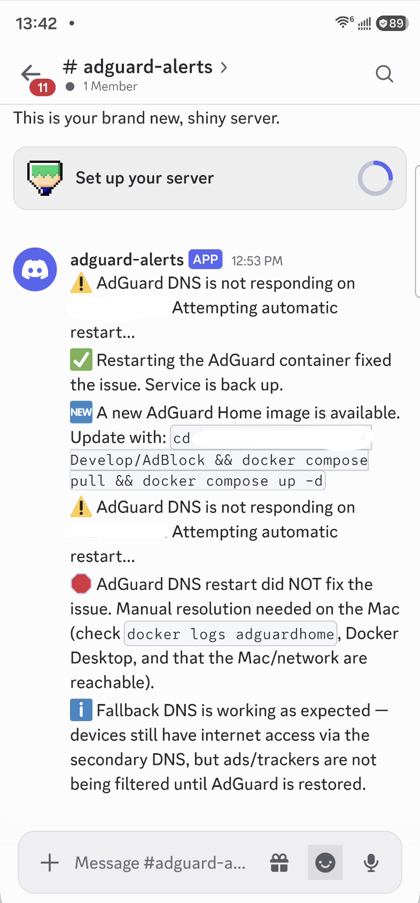

# Self-hosted DNS ad blocking with Google Nest Wifi Pro

## Goal
Network-wide ad blocking at the router level. Hardware: Google Nest Wifi Pro (Wi-Fi 6E mesh, two floors). Approach: run a self-hosted DNS filter ([AdGuard Home](https://github.com/AdguardTeam/AdGuardHome)) and point the Nest at it as custom DNS.

## Status: working, in production use
AdGuard Home runs on a Mac on the local network, the Nest is configured to use it (with a public-DNS secondary for failover), and a watchdog monitors/auto-recovers it with Discord alerts. Everything is centralized in this repo, cloned to `~/nest-adguard-home`.

> **Placeholders used throughout this doc:**
> - `<adguard-host-ip>` — the LAN IP of the machine running AdGuard Home (e.g. `x.x.x.x`)
> - `<router-ip>` — the Nest's own LAN IP, usually `x.x.x.1`
>
> Find both via your router admin page / Google Home app, or `ipconfig getifaddr en0` (macOS) for the host IP.

---

## Current setup

### Repo layout
```
nest-adguard-home/
├── docker-compose.yml        # defines the adguardhome service
├── data/
│   ├── work/                 # AdGuard runtime data (query log, stats)
│   ├── conf/                 # AdGuard config (admin login, DNS/filter settings)
│   └── watchdog.log          # watchdog's own log + state files (.watchdog_*)
├── scripts/
│   └── watchdog.sh           # monitoring/auto-recovery script, see below
├── config/
│   ├── watchdog.env           # real Discord webhook URL + local IPs (gitignored)
│   └── watchdog.env.example   # template, safe to commit
├── launchd/
│   └── local.adguard-watchdog.plist   # recurring job template (see install steps)
└── README.md                 # this file
```
`.gitignore` excludes `data/` (runtime DB, query logs, admin credentials) and any `*.env` file except the `.example` template, plus common credential/key patterns — see the file itself.

### AdGuard Home
- Upstream project: [github.com/AdguardTeam/AdGuardHome](https://github.com/AdguardTeam/AdGuardHome).
- Runs via `docker compose up -d` from this repo (image: `adguard/adguardhome`, `latest` tag).
- Host: a Mac on the LAN, at `<adguard-host-ip>`. Ports 53 (DNS, tcp+udp) and 3000 (admin UI) exposed.
- Admin UI: `http://<adguard-host-ip>:3000` (credentials set during initial setup, not recorded here).
- Verify it's filtering: `nslookup doubleclick.net <adguard-host-ip>` → should return `0.0.0.0`.

### Google Nest Wifi Pro — DNS config
Google Home app → Wi-Fi network → Settings → Advanced networking → DNS → **Custom**:
- **Primary:** `<adguard-host-ip>` (AdGuard)
- **Secondary:** `8.8.8.8` (Google Public DNS)

The secondary exists purely as a failover so the whole network doesn't lose DNS resolution if the AdGuard host goes down — see "Bugs found" below for why this was added. Note: Nest's own "Automatic" DNS mode already resolves through Google Public DNS by default (confirmed via resolver-identification queries against `whoami.akamai.net` and `o-o.myaddr.l.google.com`), so `8.8.8.8` as secondary matches what the Nest would use anyway, just explicit.

### Watchdog (`scripts/watchdog.sh`)
Runs periodically (intended via the launchd job, every 5 minutes) and does, in order:
1. **Health check** — queries AdGuard directly for a known-blocked domain (`doubleclick.net`), expects `0.0.0.0`. This catches real failures, not just "is the container running" (see bug #2 below).
2. **Auto-restart** — if unhealthy, runs `docker restart adguardhome`, rechecks up to 3× over 15s.
3. **Notifies Discord** at each transition: down detected → restart succeeded, or restart failed (manual fix needed).
4. **Fallback check** — if still down after a restart attempt, queries the Nest directly to see if clients are getting a working fallback resolution. Notifies whether fallback is working (devices have internet, just unfiltered) or not.
5. **Internet check** — if fallback also isn't working, pings `1.1.1.1` directly (no DNS involved) to distinguish "DNS problem" from "your internet is actually down," and notifies accordingly.
6. **Update check** — once per day (gated by a timestamp file, not every run), pulls the `latest` AdGuard image and compares its digest to what's actually running. Notifies once per new version with the exact update command. Never auto-updates.

State is tracked in small flag files under `data/.watchdog_*` so Discord only gets notified on *transitions*, not spammed every 5 minutes while something stays broken.

Example notifications from a real Discord channel, covering an outage/restart cycle, an update alert, and a restart that didn't fix the issue followed by a working-fallback notice:



**Setup (one-time):**
1. Copy the template and fill in your real values:
   ```bash
   cp ~/nest-adguard-home/config/watchdog.env.example ~/nest-adguard-home/config/watchdog.env
   ```
   Edit `config/watchdog.env`:
   ```bash
   DISCORD_WEBHOOK_URL="your-discord-webhook-url"
   ADGUARD_IP="<adguard-host-ip>"
   NEST_IP="<router-ip>"
   ```
2. Install the recurring job. `launchd` requires an absolute path with no `~`/env-var expansion, so the committed plist uses a placeholder (`__REPO_DIR__`) that gets substituted at install time — this keeps your real username out of the repo:
   ```bash
   sed "s#__REPO_DIR__#$HOME/nest-adguard-home#g" ~/nest-adguard-home/launchd/local.adguard-watchdog.plist > ~/Library/LaunchAgents/local.adguard-watchdog.plist
   launchctl load ~/Library/LaunchAgents/local.adguard-watchdog.plist
   ```

---

## Bugs found during setup, and fixes

### 1. Nest custom DNS setting silently failed to save
First attempt at setting Custom DNS in the Google Home app appeared to go through but didn't actually persist — navigated away without tapping Save. Caught by testing `nslookup doubleclick.net <router-ip>` (querying the Nest directly) and seeing it return a real IP instead of `0.0.0.0`. **Fix:** always re-verify with a direct query to the Nest after changing DNS settings; don't just trust the UI.

### 2. Android "Private DNS" bypassing the whole setup
A test Android phone kept showing ads even after the Nest was correctly configured. Root cause: Settings → Network & internet → Private DNS was set to **Automatic**, which opportunistically tries DNS-over-TLS — on networks where this fails or isn't what you expect, it can route around whatever DNS the network (DHCP) hands out entirely. Diagnosed via `adb shell dumpsys connectivity` showing the device's actual resolved DNS server, and `adb shell settings get global private_dns_mode`.
- Turning Private DNS **Off** forced the phone to use the network's DNS and confirmed the real issue.
- Re-tested with Private DNS back on **Automatic**: on this network it resolved to `opportunistic` mode actually using the Nest (`<router-ip>`) over DoT, not bypassing it — so Automatic turned out to be safe here. **This is network-dependent — re-check this setting per device if ads reappear on a specific device**, since opportunistic mode's behavior depends on whether the local DNS server supports DoT.

### 3. Single point of failure: the AdGuard host going down took out DNS for the whole network
With only a primary DNS configured (no secondary), when the Mac running AdGuard went offline, every device relying on the Nest for DNS (phone, TV, even the Mac itself) lost DNS resolution entirely — looked exactly like "internet is down," even though the connection was fine. Non-DNS-dependent devices (Google Home Minis, smart lights — likely using cached/cloud connections or Thread mesh) kept working, which was the tell that this was a DNS-specific failure, not a real outage.
- **Fix:** added `8.8.8.8` as a secondary DNS entry on the Nest (see "Current setup" above). This was deliberately *not* done during initial testing (a secondary can mask whether the primary is actually being used), but is the right production configuration once the primary path was verified working.
- Tradeoff: during an AdGuard outage, ads go unfiltered (fallback doesn't block anything) rather than DNS failing outright. Confirmed via live test: stopped/removed the AdGuard container, verified `doubleclick.net` resolved to a real IP via the Nest's fallback instead of timing out.

### 4. AdGuard container reporting "running" while actually non-functional
Separately from an intentional stop, the container was once found in `Up` status via `docker ps` but completely unresponsive to DNS queries. Docker logs showed internal errors trying to reach its own upstream resolvers (Quad9) — a Docker Desktop VM networking glitch, most likely triggered by the host machine sleeping/waking. `docker ps` showing "Up" was not a reliable health signal.
- **Fix:** `docker restart adguardhome` recovered it immediately.
- **This is exactly why the watchdog's health check does a real DNS query** rather than checking container status — a "running" container can still be silently broken.

---

## Verified test results (live, with real notifications)
- AdGuard blocks standard ad/tracker domains network-wide (`doubleclick.net` → `0.0.0.0`) and resolves normal domains correctly.
- Nest correctly forwards to AdGuard as primary.
- Outage → auto-restart → recovery: watchdog detected, restarted, and confirmed recovery with Discord notifications at each step.
- Outage where restart doesn't help (container fully removed): watchdog correctly reported "manual resolution needed" rather than falsely claiming success.
- Fallback-DNS-working path: verified both via the watchdog's own notification and independently via direct `nslookup` against the Nest while AdGuard was down.
- Update-available detection: verified against a real older AdGuard release (v0.107.78 vs. actual latest v0.107.79) — correctly notified once, with the exact update command.
- **Known, expected limitation:** in-app YouTube ads are not blocked and can't be via DNS filtering — YouTube serves ads from the same domains/CDN as regular video content (`googlevideo.com`), so blocking those domains would break YouTube entirely. No DNS-based filter (Pi-hole, AdGuard Home, NextDNS) solves this.
- **Untested:** the "fallback not working AND internet down" notification path (step 5 of the watchdog) — would require actually breaking internet connectivity to trigger safely, not attempted.
- **Still untested:** the original IPv6 leak concern (Nest may hand out ISP DNS via SLAAC/router advertisements to IPv6-capable clients, bypassing the filter over IPv6 entirely).

---

## Revert plan (how to undo everything, in order)

**A. Revert the Nest to stop using AdGuard:**
1. Google Home app → Wi-Fi network → Settings → Advanced networking → DNS → select **Automatic** → Save. Confirm it actually completes (watch for the spinner — it silently failed to save once before, see Bug #1).
2. This alone returns all devices to ISP/Google default DNS; AdGuard becomes unused but harmless.

**B. Stop or remove AdGuard Home (optional, once A is done):**
```bash
cd ~/nest-adguard-home
docker compose stop        # pause, keep config
docker compose down        # stop + remove container, data/ on disk is untouched
```
To remove everything including config/history: also `rm -rf data/`.

**C. Uninstall the watchdog (if the launchd job was installed):**
```bash
launchctl unload ~/Library/LaunchAgents/local.adguard-watchdog.plist
rm ~/Library/LaunchAgents/local.adguard-watchdog.plist
```

**D. Android Private DNS:** no action needed — "Automatic" is fine to leave as-is regardless of whether the rest of this is reverted.

**E. Nothing else was changed.** No other devices or router settings were touched beyond the DNS field in step A.

---

## Open items (from original research, still unresolved)
- IPv6 leak: not yet tested on this network — check whether your ISP provides IPv6, and if so whether the Nest's router advertisements bypass AdGuard.
- Long-term host decision: currently running on a Mac, which can sleep/reboot (see Bug #4) and caused one real outage. Original plan considered a Raspberry Pi for a true always-on host — not done; the watchdog + secondary DNS fallback was chosen as a mitigation instead, not a replacement for an always-on host.
- Wi-Fi 7 mesh alternatives (ASUS AiMesh, eero 7/Pro 7, TP-Link Deco BE, GL.iNet Flint 3) were researched as fallback options if the DNS approach didn't pan out — now moot since the AdGuard setup works, but kept below for reference if the Nest itself is ever replaced.

### Wi-Fi 7 alternatives (reference only, not currently pursued)
- ASUS Wi-Fi 7 + AiMesh: AdGuard DNS built into the router admin panel. Verify AiMesh pairing and the AdGuard setting on nodes before buying.
- Amazon eero 7 / Pro 7: ad blocking requires the eero Plus subscription (conflicts with custom DNS); custom DNS works with Plus off. Eero 7 is dual-band only, Pro 7 is tri-band. Built-in Thread border router.
- TP-Link Deco BE: custom DNS via Deco app (Router mode only), no built-in blocking, limited DNS features, guest-network issues with custom DNS.
- GL.iNet Flint 3 (BE9300, about $210): best built-in AdGuard Home, but no native mesh; would need a wired access point upstairs.
- Note: Nest Wifi Pro is also a Thread border router. Replacing it affects Thread/Matter devices.
- An Ethernet backhaul between floors helps a mesh more than the model choice.
